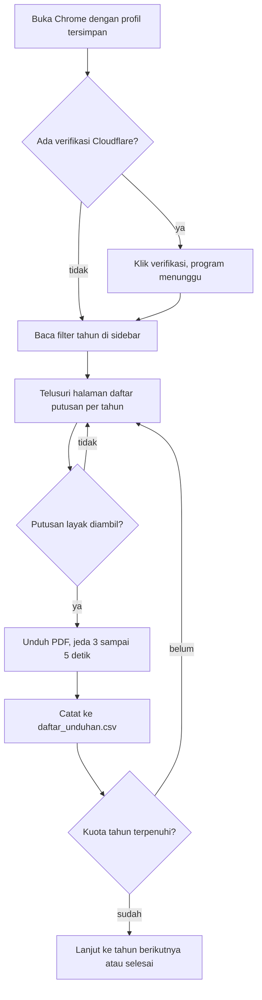

<div align="center">

# Crawler Putusan Narkotika PN Bangil

Program pengunduh putusan pidana narkotika tahun 2023 sampai 2025 dari Direktori Putusan Mahkamah Agung


</div>

Repositori ini berisi program untuk mengunduh putusan PN Bangil kategori Narkotika dan Psikotropika sebanyak 60 putusan (20 per tahun). Datasetnya ada di folder [Dataset](Dataset/), sedangkan daftar hasil unduhan dan ringkasannya ada di folder [Overview](Overview/).

```
.
├── README.md
├── Program_Crawler_PN-Bangil.ipynb     program crawler
├── Dataset/                            dataset 60 putusan (ZIP)
└── Overview/                           daftar_unduhan.csv, daftar 60 putusan yang diunduh
```

---

## Dataset

| | |
|---|---|
| Berkas | `putusan_Narkotika_PN-Bangil.zip` di folder [Dataset](Dataset/) |
| Isi | 60 putusan dalam format PDF |
| Sumber | [putusan3.mahkamahagung.go.id](https://putusan3.mahkamahagung.go.id/), PN Bangil, Narkotika dan Psikotropika |
| Periode | putusan 2023, 2024, 2025 (masing-masing 20) |
| Tanggal pengambilan | 4 November 2026 |

Nama file PDF mengikuti format unduhan situs MA:

```
putusan_423_pid.sus_2023_pn_bil_20261104210156.pdf
        |     |       |    |         |
     nomor  jenis  tahun  kode PN   waktu unduh (tahun-bulan-hari jam-menit-detik)
```

File di atas adalah perkara 423/Pid.Sus/2023/PN Bil.

---

## Overview

Folder [Overview](Overview/) berisi daftar putusan yang diunduh beserta ringkasan hasil crawling.

### Daftar unduhan

File `daftar_unduhan.csv` di folder ini mencatat satu baris untuk setiap putusan yang berhasil diunduh.

| Kolom | Isi |
|---|---|
| No | urutan unduhan (1 sampai 60) |
| Tahun | tahun putusan |
| File | nama file PDF |
| Status | status tingkat proses di halaman putusan |
| URL | alamat halaman putusan di situs MA |
| NoWeb | nomor perkara menurut halaman putusan |

Contoh tiga baris pertama (kolom URL tidak ditampilkan):

| No | Tahun | File | Status | NoWeb |
|---|---|---|---|---|
| 1 | 2023 | putusan_423_pid.sus_2023_pn_bil_20261104210156.pdf | Pertama (tingkat proses) | 423/Pid.Sus/2023/PN Bil |
| 2 | 2023 | putusan_428_pid.sus_2023_pn_bil_20261104210201.pdf | Pertama (tingkat proses) | 428/Pid.Sus/2023/PN Bil |
| 3 | 2023 | putusan_359_pid.sus_2023_pn_bil_20261104210205.pdf | Pertama (tingkat proses) | 359/Pid.Sus/2023/PN Bil |

### Ringkasan per tahun

Seluruh 60 putusan berstatus tingkat pertama.

| Tahun | Total di situs | Diambil | Rentang nomor perkara | Halaman daftar | Dilewati: tanpa PDF | Dilewati: bukan PN Bangil |
|:---:|:---:|:---:|:---:|:---:|:---:|:---:|
| 2023 | 199 | 20 | 141 - 442 | 10 | 0 | 0 |
| 2024 | 205 | 20 | 289 - 406 | 11 | 3 | 0 |
| 2025 | 263 | 20 | 437 - 563 | 14 | 9 | 3 |
| Total | 667 | 60 | | | 12 | 3 |

Kolom "Total di situs" diambil dari angka pada filter tahun di sidebar saat crawling berjalan. Dari 667 putusan itu kami ambil 60 (sekitar 9%), diurutkan dari daftar paling atas untuk tiap tahun, jadi sampelnya bukan sampel acak.

Selama crawling ada 12 putusan yang dilewati karena halamannya tidak menyediakan PDF dan 3 halaman yang ternyata bukan milik PN Bangil. Tidak ada unduhan yang gagal, dan tidak ada putusan berstatus inkracht yang ikut terambil.

---

## Crawler

File: [Program_Crawler_PN-Bangil.ipynb](Program_Crawler_PN-Bangil.ipynb)

Situs Direktori Putusan MA dilindungi verifikasi Cloudflare, jadi percobaan awal dengan `requests` selalu ditolak (HTTP 403). Karena itu crawler memakai Playwright untuk membuka Chrome sungguhan. Kalau kotak verifikasi muncul, klik manual di jendela Chrome dan program akan lanjut sendiri (menunggu maksimal 5 menit). Hasil verifikasi disimpan di folder `chrome_profile/` sehingga run berikutnya biasanya tidak diminta lagi.

### Alur kerja



Putusan dianggap tidak layak jika halamannya hanya tautan sidebar, bukan milik PN Bangil, tidak punya tautan PDF, atau berstatus inkracht (kalau `SKIP_INKRACHT = True`).

### Yang dilakukan program

- Mengunduh putusan per tahun sesuai kuota, satu permintaan dalam satu waktu dengan jeda acak 3 sampai 5 detik.
- Membaca nomor perkara dari halaman putusan, lalu memakainya untuk nama file. Kalau nomornya tidak terbaca, nama file memakai nomor urut. Jika ada nama yang sama, ditambah akhiran angka.
- Mencatat tiap unduhan ke `daftar_unduhan.csv`.
- Menyimpan HTML dan screenshot halaman bermasalah ke folder `debug/` untuk dicek.

### Cara menjalankan

Kebutuhan: Python 3.9 atau lebih baru, VS Code dengan ekstensi Python dan Jupyter, dan Google Chrome (kalau tidak ada, dipakai Chromium bawaan Playwright).

1. Taruh notebook di folder kosong, lalu buka di VS Code.
2. Jalankan sel pertama untuk memasang paket yang dibutuhkan.
3. Jalankan sel instalasi Chromium (cukup sekali).
4. Jalankan sel crawling. Jangan tutup jendela Chrome selama proses berjalan. Untuk 60 putusan, kira-kira 9 menit.

### Setelan

```python
QUOTA = {2023: 20, 2024: 20, 2025: 20}   # jumlah putusan per tahun
SKIP_INKRACHT = True                      # True: lewati putusan berstatus tetap (inkracht)
PROFILE = os.path.abspath("chrome_profile")
```

### File yang dihasilkan

```
pdf/                    putusan yang diunduh
daftar_unduhan.csv      daftar unduhan
debug/                  halaman bermasalah (HTML dan screenshot)
chrome_profile/         profil Chrome, jangan ikut diunggah
```

### Kalau ada masalah

| Masalah | Penyebab dan solusi |
|---|---|
| Halaman tertahan di "Just a moment" | Klik kotak verifikasi di jendela Chrome. Kalau tetap gagal, hapus `chrome_profile/` lalu ulangi |
| Muncul "Chrome asli tidak ada" | Chrome tidak terpasang, program memakai Chromium. Pastikan sel instalasi Chromium sudah dijalankan |
| Error "Playwright Sync API inside the asyncio loop" | Jalankan lewat `jalankan_crawler()` seperti di notebook, jangan memanggil `download_all()` langsung |
| Muncul "tak ada link PDF" | Halaman putusan itu memang tidak menyediakan PDF, otomatis dilewati |
| Tahun di sidebar tidak terbaca | Lihat isi folder `debug/` untuk melihat halaman yang diterima program |

---

## Tim penyusun

| Nama | NIM | GitHub |
|---|---|---|
| Mohammad Ravlindo S | 202310370311115 | [ravlindoMs](https://github.com/ravlindo) |
| Mukhamad Sofyan | 202310370311135 | [MukhamadSofyan](https://github.com/mukhamadsofyan) |